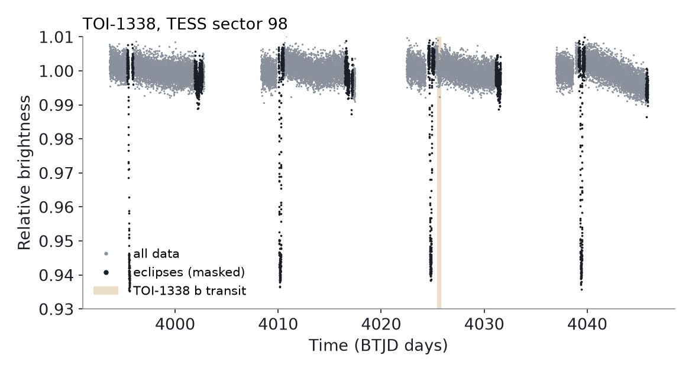
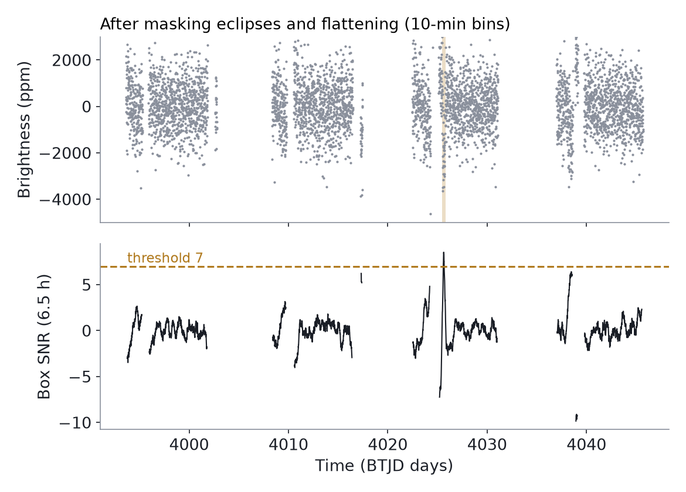
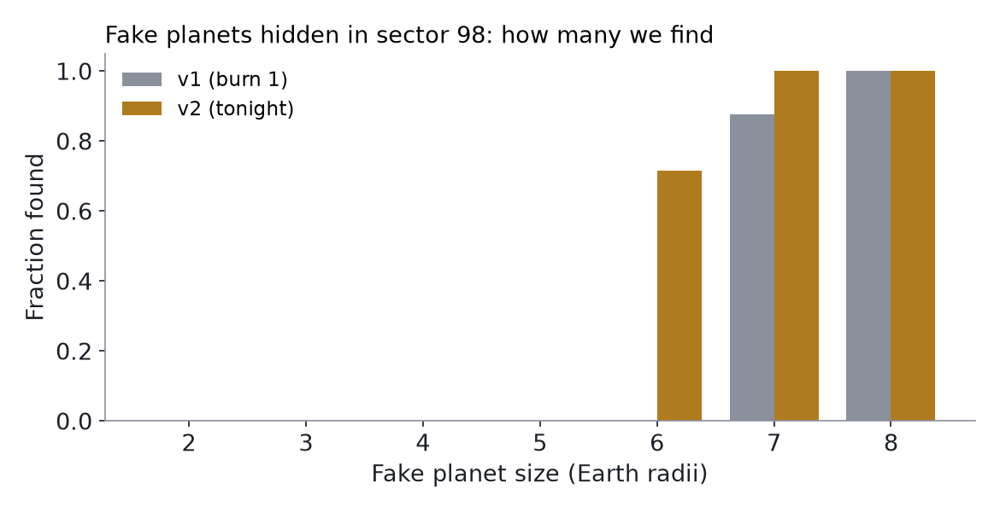

# 4. Our detector: finding a dip in the noise

Chapter 4 · about 30 min · Maths: averages, square roots, ratios · Code: <code>pipeline/detect_v2.py</code>

!!! plain "In plain words"
    Ahmed, this is the heart of the hunt: a program that scans a light curve and points at dips that might be planets. On 20 October 2026 we rebuilt it ("v2") and tested it honestly. It finds the known planet TOI-1338 b in half the sectors where it crossed. It catches fake planets about **6 times Earth's size** and up, but not smaller ones, in a star this bright. This chapter shows how it works, step by step, and why the limit is mostly the data, not the code.

**What this chapter answers:** how does our search decide "this might be a planet", and how good is it?

## 4.1 The intuition

You're listening for a quiet whistle in a noisy room. A single loud clap could fool you, so you don't react to one instant. Instead you ask: "is it consistently a bit different for a few seconds?" A long, steady change is easier to pick out than a single blip, even if it's quiet.

A transit is that steady change: a small dip lasting hours. Our detector averages the light over a few hours at a time and asks whether any stretch is unusually dim compared with how much stretches normally wobble.

## 4.2 The scientific meaning

The method is a **matched filter** with a **box** shape: we slide a box-shaped template of a given length along the data and measure how dim each stretch is. The key number is the **signal-to-noise ratio (SNR)**:

SNR = (how much dimmer this stretch is) ÷ (how much stretches of this length normally vary)

An SNR of 7 means "seven times bigger than a normal wobble". We use 7 as the bar, close to NASA's 7.1 {{claim:F-017}}. But a bar only means something if we **measure** how often noise alone crosses it. That's why we also run the search on flipped data (section 4.5).

## 4.3 The technical explanation

The steps, with every symbol:

1. **Mask the eclipses.** The stars eclipse each other every binary period *P*bin. We use the known *P*bin (14.6084 days for TOI-1338) and find where in that cycle the deep eclipse falls in each sector. Data within 1.5 eclipse-lengths of either eclipse is set aside.
2. **Flatten (detrend).** Stars and the spacecraft cause slow drifts. We fit a smooth curve with a moving window of **2 days** (a "biweight", which ignores outliers) and divide it out. The window must be much longer than a transit, or the flattening eats the dip. v1 used 1 day, which was too short for 6-hour dips.
3. **Bin.** Average the 2-minute points into **10-minute bins**.
4. **Slide boxes.** For each length *D* in 3, 4, 5, 6.5, 8, 10, 12 and 15 hours, compute the average brightness *m* of every *D*-long stretch.
5. **Score.** For each length, SNR = (*median* − *m*) ÷ *σ*D, where *σ*D is the **robust spread of all the box averages of that length** (1.4826 × the median absolute deviation, a version of the standard deviation that isn't thrown off by a few odd values).
6. **Keep peaks** with SNR ≥ 7 and merge overlapping ones into one event.

Why step 5 measures the spread from the box averages themselves: if the noise were purely random ("white"), averaging *N* points would shrink it by √*N*. Real data has slow wiggles ("red noise") that don't average away. Measuring the spread of real box averages includes those wiggles, so the SNR stays honest.

## 4.4 Our implementation (the code)

All of this is in `pipeline/detect_v2.py`, about 130 lines. The important functions:

| Function | Input | Output | What can go wrong |
|---|---|---|---|
| `load(path)` | a SPOC light-curve file | time `t`, flux `f`, number of gaps filled | missing PDCSAP data (filled from SAP) |
| `eclipse_mask(t, f, P, ...)` | data + binary period and eclipse lengths | which points to keep | wrong period or eclipse lengths leave eclipse edges in |
| `detrend(t, f, window_d=2.0)` | kept data | flattened flux | gaps create edge effects (Figure 4.2) |
| `box_scores(bt, bf, dur_h)` | 10-min bins, one length | box centres, SNR, box averages | too few bins → no score |
| `find_events(t, f, thr=7)` | kept data | list of events (time, length, SNR, depth) | noise bumps above 7 (false alarms) |

Running `python detect_v2.py` runs a **self-check**: 27 days of pure random noise must give no event, and a hidden 6-hour, 700 ppm dip must be found at the right time. Both pass (CONFIRMED, ran on 2026-10-20).

## 4.5 Worked example: TOI-1338, sector 98

<figure markdown>
{ width="100%" loading="lazy" }
<figcaption>Figure 4.1. The raw light curve. The black streaks are the stars eclipsing each other (masked before searching). The amber band is TOI-1338 b's transit on 16 Dec 2025. Data: NASA TESS via MAST.</figcaption>
</figure>

<figure markdown>
{ width="100%" loading="lazy" }
<figcaption>Figure 4.2. After masking and flattening (top), the 6.5-hour box score (bottom) crosses 7 only at the planet. Look at the sharp swings beside gaps (near days 4024.5 and 4038.5): edges of gaps cause fake signals, one of our known weaknesses.</figcaption>
</figure>

The search finds the transit with SNR **9.0**, depth about **2,100 ppm**, about **1.1 hours** after Wang and Liu's predicted time {{claim:F-011}}.

### How good is it? Three honest tests

**1. Re-finding the known planet.** TOI-1338 b crossed in 8 sectors where we have data at the right moment. v2 finds it in **4** {{claim:F-014}}. In the 4 it misses, the dip is only 3.7 to 6.5 times the noise: below our bar.

**2. Fake planets.** We hid computer-made transits of known sizes in sector 98 and ran the search {{claim:F-015}}:

<figure markdown>
{ width="100%" loading="lazy" }
<figcaption>Figure 4.3. Fake planets found, by size. v2 (amber) reaches about 6 Earth radii; neither version finds 5 or smaller in this star.</figcaption>
</figure>

**3. False alarms.** Turn the light curve upside down (2 − flux). Now any real dip becomes a bump, so anything the search finds is **noise or spacecraft effects**. At SNR 7, v2 still finds **6 fake events in 10 sectors**, some as strong as SNR 12.6 {{claim:F-016}}. That's why we can't just lower the bar.

### A fourth test: can we clean up the fakes automatically?

Many fake dips sit next to a **data gap** (where the spacecraft paused) or a **momentum dump** (a short thruster firing that jolts the pointing). So I tried rejecting any dip close to one. It removed 4 of the 6 fakes, but it also threw away **2 of the 4 real crossings** of TOI-1338 b: one sat 0.17 days from a thruster firing, the other 0.09 days from a gap. On this star, real and fake dips sit at the same kinds of distances, so no cut-off separates them.

So the rule became gentler. Closeness to a gap or a firing is now a **warning flag** shown to a human, not an automatic rejection. Only a dip that also appears in the flipped data is thrown out. Result: all 4 real crossings kept, and 4 of the 6 fakes carry a warning (`pipeline/veto_test.py`, CONFIRMED). The lesson: with one dip at a time, you can't clean this data without losing planets. You need several dips that fit **one orbit**.

### A fifth test: the same dip in a second, independent product

Half of your G1 stars only have **QLP** light curves (made by MIT from TESS's full-frame pictures, Chapter 6). So I ran the search on QLP's version of sector 98.

- **First try: a mess.** QLP's raw light had fake dips up to **44 times the noise**, and QLP's own cleaned version shrank the planet's 2,400 ppm dip to about 700 ppm (its cleaning eats long dips). The planet was missed both ways.
- **The clue:** every strong fake sat inside stretches of time that NASA's SPOC pipeline **throws away** (scattered light that comes back at the same point in each TESS orbit). QLP keeps those stretches.
- **The fix:** use QLP's flux that keeps long dips (`sys_rm_flux`) and keep only SPOC's good stretches. Result: **one event, the planet**, at SNR 10.1 and 2,275 ppm, within about 9 minutes of where SPOC put it. Fakes dropped from 9 to 2.

That's rule C8 from Chapter 5 in action: the same dip, at the same time, in two products made by different teams. CONFIRMED for this one sector; borrowing SPOC's good stretches for stars that have no SPOC file is still untested.

## 4.6 What this lets us conclude, and what it doesn't

- **We can conclude:** the code works as designed (self-check), it finds a real planet transit when the transit is strong enough, and for a star like TOI-1338 its single-sector floor is about **6 Earth radii**.
- **We can't conclude:** that "nothing found" means "no planet". It means "nothing bigger than about 6 Earths crossed in this sector", and only for stars this bright or brighter.
- **The limit is mostly the data.** The planet's missed dips are genuinely weak in those sectors, and spacecraft effects make bumps as strong as real dips. Better code alone won't fix that.
- **What would help** (the next steps): reject events near gaps, momentum dumps and flagged data (a "systematics veto"); and **stack** a planet's crossings using the binary's known orbit, the way the STANLEY tool does, instead of judging each dip alone.

!!! warning "Not a discovery"
    TOI-1338 b has been known since 2020. Everything in this chapter is a test of our tools on a known planet.

## 4.7 Check your understanding

??? quiz "1. Why did v1's 1-day flattening window hurt us?"
    A 6-hour dip is a quarter of a day. A 1-day moving fit partly follows the dip down and "flattens" it away, making it shallower than it really is.

??? quiz "2. Why do we search flipped (upside-down) data?"
    Real dips become bumps, so anything found there is noise or spacecraft effects. It **measures** our false-alarm rate instead of guessing it.

??? quiz "3. The search finds nothing in a star. What can you say?"
    Only that no transit stronger than our bar happened in that data: roughly nothing bigger than ~6 Earth radii for a TOI-1338-like star. Smaller planets, or planets not crossing during that sector, could still be there.

## Sources
In the [claims register](../claims.md): F-011, F-014 to F-017. Full test report: `research/overnight-science/report.md`. Code: `pipeline/detect_v2.py`, `pipeline/accept_v2.py`, `pipeline/diag_v2.py`, `pipeline/book_figures.py`.
