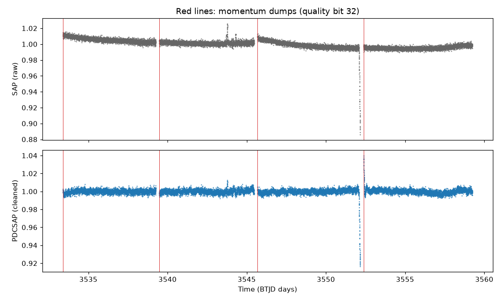

# Lab 3: plot a light curve and measure its noise

<p class="ss-meta">Lab · at your PC · about 20 min · Level L1 · after Lab 2 and Chapter 2</p>

!!! plain "In plain words"
    You draw the Kepler-16 file from Lab 2 as a graph, raw and cleaned, with the thruster firings marked. Then the script measures how much the brightness wobbles when you average 10 minutes, 1 hour, 3 hours or 6 hours of data. That table is how you judge whether a dip is real (Chapter 7).

**Goal:** see a real light curve with your own eyes, and measure its noise the way our search does.

## Do it

```powershell
cd D:\second-sun
.\.venv\Scripts\python.exe labs\lab3_plot_and_read.py
```

Then open the picture it saves: `D:\second-sun\labs\out\lab3_tic299096355.png`.

## What you should see

```text
TIC 299096355, sector 82, binary period from G1 list: 41.0775867 d
Picture saved: D:\second-sun\labs\out\lab3_tic299096355.png
Eclipses masked: 1.3% of the good data

    bin points  measured  if white   (scatter in ppm)
  2 min      1      2015      2015
 10 min      5      1166       901
    1 h     30       908       368
    3 h     90       800       212
    6 h    180       577       150
```

<figure markdown>
{ width="100%" loading="lazy" }
<figcaption>Kepler-16, sector 82, from your PC. Top: raw (SAP). Bottom: cleaned (PDCSAP). Red lines: momentum dumps.</figcaption>
</figure>

## Reading the picture

- **The deep drop near BTJD 3552** is the two stars eclipsing each other: the small star passes in front of the big one. It's about 8 to 12% deep, far deeper than any planet. The binary's period is 41.08 days, so a 26-day sector catches at most one of each kind.
- **Raw vs cleaned.** The raw curve drifts and jumps at each gap. NASA's cleaning flattens those drifts, but look just after the eclipse: the cleaned curve **spikes up** where the raw one doesn't. Cleaning can create problems as well as remove them.
- **The small bump near 3544** in the raw data is gone in the cleaned data. Something on the camera, not the star.
- **The red lines** are thruster firings, about every 6 days {{claim:F-028}}. One sits right at the end of the eclipse, exactly where the cleaned curve spikes: two problems in one place, so that stretch needs care.

## Reading the table

- **2 min:** one measurement wobbles by about 2,000 ppm (0.2%).
- **"If white"** is what averaging *should* give if every wobble were independent: divide by √N (Chapter 7).
- **Measured** stays much higher. Over 1 hour it's 908 ppm, not 368. Slow wobbles don't average away. That's **red noise**, and it's why a 5-hour planet dip of 1,000 ppm would be hard to see here.

!!! warning "Why this lab corrected our own number"
    While building this lab I found that an earlier estimate of Kepler-16's one-hour noise (236 ppm) used a quick method that flattens away most of the slow wobble. The real figure for our search is about 900 ppm {{claim:F-039}}. Chapter 7 tells the story; it's logged in the mistakes register.

## How the script works

1. Reads the file and finds the binary's period in our G1 list by the TIC number.
2. Plots raw and cleaned brightness, divided by their middle value so 1.0 means "normal".
3. Keeps only quality-0 rows, flattens slow trends with the same 2-day filter our detector uses, and masks the eclipses.
4. For each bin size, averages groups of points and measures the spread with a **robust** method (it ignores a few wild points).

## What can go wrong

| You see | Why | Fix |
|---|---|---|
| `IndexError` at the start | No Kepler-16 sector 82 file yet | Do Lab 2 first |
| `binary period from G1 list: None` | The star isn't in G1 | Fine; eclipses just won't be masked |

## Your turn

Run it on the sector you downloaded in Lab 2's "Your turn" (2019). Give the path to the file:

```powershell
.\.venv\Scripts\python.exe labs\lab3_plot_and_read.py "PASTE-THE-PATH-FROM-LAB-2-HERE"
```

**Tell me:** your 1-hour "measured" and "if white" numbers. Is the 2019 sector quieter or noisier than 2024? Does the picture show an eclipse?

**Next:** [Chapter 7: noise and statistics](../book/07-noise-and-statistics.md), then [Lab 4](lab4-find-a-dip.md).
