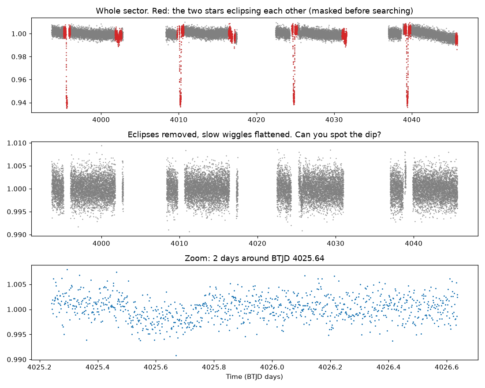

# Lab 4: find a planet's dip

<p class="ss-meta">Lab · at your PC · about 20 min · Level L3 · after Chapters 7 and 8</p>

!!! plain "In plain words"
    You look at one month of TOI-1338 data, the system with a known two-star planet. First you try to spot the planet's dip by eye. Then you run our real search on it and see whether it agrees with you. This is the core move of the whole hunt.

**Goal:** find a real planet transit, by eye and with our detector.

## Do it

```powershell
cd D:\second-sun
.\.venv\Scripts\python.exe labs\lab4_find_a_dip.py
```

**Before you read the output:** open `D:\second-sun\labs\out\lab4_toi1338_s98.png`, cover the bottom panel with your hand, and look at the middle panel. Where do you think the dip is? Write down your guess.

## What you should see

```text
Warning: 37% (14957/40278) of the cadences will be ignored due to the quality mask (quality_bitmask=24319).
25321 good measurements; eclipses of the two stars cover 15.1% and are masked
Events above SNR 7: 1
  centre BTJD 4025.638  length 5.0 h  SNR 8.5  depth 1989 ppm
Picture saved: D:\second-sun\labs\out\lab4_toi1338_s98.png
```

<figure markdown>
{ width="100%" loading="lazy" }
<figcaption>TOI-1338, sector 98, from your PC. Top: deep primary and shallow secondary eclipses of the two stars (red). Middle: eclipses removed and flattened. Bottom: the planet's dip.</figcaption>
</figure>

## Reading it

- **The warning line:** 37% of this sector is thrown away by the quality filter. That's a lot, and it's mostly **scattered light** (Lab 2's bits 2048 and 4096). Compass flagged this: some of that data could be kept with a warning instead. It's on the list.
- **15.1% masked:** TOI-1338's stars eclipse every 14.6 days, and each eclipse plus a safety margin is cut out. A planet crossing during an eclipse is lost (Chapter 9 measured about 1 in 11).
- **One event, SNR 8.5, 5 hours, 1,989 ppm, at BTJD 4025.638** {{claim:F-040}}. That's 16 December 2025, the crossing a 2024 paper predicted {{claim:F-011}}. A 1,989 ppm dip on a star 1.25 times the Sun's size means a planet about 6 Earth radii across (Chapter 2's depth formula), close to TOI-1338 b's published size {{claim:F-003}}.
- **Could you see it by eye?** In the middle panel, honestly, barely. In the zoom, yes: about 0.2% lower for a few hours. That's why we need a search with a measured false-alarm rate (Chapter 7) rather than eyes alone.

## How the script works

1. `load()` reads the file, uses the cleaned flux and drops flagged rows.
2. `eclipse_mask_auto()` folds the data at the binary's 14.6-day period, finds both eclipses, and masks them.
3. `find_events(..., thr=THR)` is the detector from Chapter 8: flatten with a 2-day filter, average into 10-minute bins, slide boxes of 3 to 15 hours, and keep anything more than 7 times the measured noise.

## What can go wrong

| You see | Why | Fix |
|---|---|---|
| `IndexError: list index out of range` | The sector 98 file isn't on D: | Tell me; it was downloaded on 19 October |
| More than one event | You changed the threshold | The default bar is SNR 7 |

## Your turn

1. Copy `labs\lab4_find_a_dip.py` to `labs\lab4_mine.py` (same folder). Open the copy in Notepad, find the line `THR = 7.0` near the top, and change it to `THR = 5.0`: a lower bar. Save.
2. Run your copy: `.\.venv\Scripts\python.exe labs\lab4_mine.py`. How many events now? Look at where each one sits in the picture.
3. **Think:** which of them would you trust, and why? Chapter 8's flipped-data test is the clue.

**Tell me:** "Lab 4 done", your guess from the picture, and how many events appeared at SNR 5.

**Next:** [Chapter 9: fake planets](../book/09-fake-planets.md).
