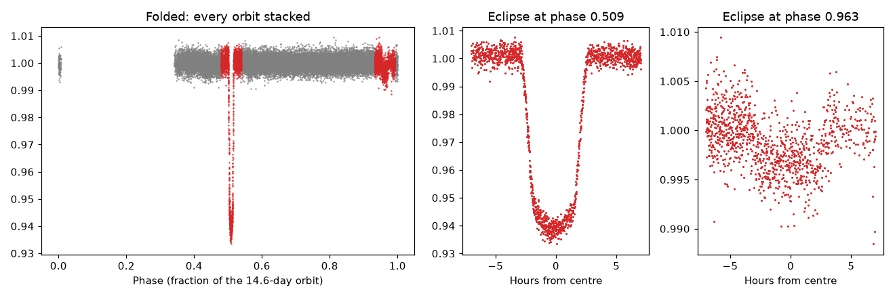

# Lab 5: two suns up close

<p class="ss-meta">Lab · at your PC · about 15 min · Level L4 · after Chapter 6</p>

!!! plain "In plain words"
    You take one month of TOI-1338 data and "fold" it: cut it into 14.6-day pieces (one orbit of the two stars) and stack them. Both eclipses line up and become easy to see and measure. This is how our search finds and hides the stars' own eclipses before looking for a planet.

**Goal:** see both eclipses of a real binary, measure them, and see what gets masked.

## Do it

```powershell
cd D:\second-sun
.\.venv\Scripts\python.exe labs\lab5_two_suns.py
```

## What you should see

```text
Folded 25321 measurements at P = 14.6086 d. Eclipses found: 2
  phase 0.509: depth 5.67%, width about 5.3 h
  phase 0.963: depth 0.32%, width about 5.3 h
Second eclipse comes 0.453 of an orbit after the first (0.500 would mean a circular orbit)
Masked before searching: 15.1% of the data
Picture saved: D:\second-sun\labs\out\lab5_toi1338_fold.png
```

<figure markdown>
{ width="100%" loading="lazy" }
<figcaption>TOI-1338, sector 98, folded at 14.6086 days, from your PC {{claim:F-046}}. Red: masked. Middle: the primary eclipse. Right: the secondary.</figcaption>
</figure>

## Reading it

- **Phase** is where in the stars' orbit a measurement sits, from 0 to 1. Folding puts all orbits on top of each other.
- **The deep eclipse (phase 0.509):** the small star passes in front of the big one and blocks about 6% of the light at the bottom. The script reports 5.67%, the typical value inside the masked stretch. With Chapter 2's formula, √0.06 ≈ 0.24: the small star is about a quarter of the big one's size.
- **The shallow eclipse (phase 0.963):** the big star hides the small, faint one. Only 0.3% of the light disappears, because the small star gives so little light.
- **0.453, not 0.5:** the orbit is stretched (Chapter 6).
- **The gap from phase 0.02 to 0.35.** Look at the picture: almost no data there. The quality filter dropped 37% of this sector (Lab 4), mostly scattered light that returns once per TESS orbit. TESS's own orbit (13.7 days) is close to the stars' 14.6 days, so the dropped stretches likely keep landing on the same part of the stars' orbit. A planet crossing during that part of the orbit would be invisible in this sector.
- **15.1% masked:** each eclipse plus a safety margin of 1.5 times its width on both sides. Any planet crossing in there is lost to the search (Chapter 9: about 1 in 11).

## How the script works

1. `eclipse_mask_auto()` (in `pipeline/detect_v2.py`) folds at the period, takes the middle value in 600 phase slices, and flags slices more than 4 times the noise below normal. Each flagged run is an eclipse.
2. The script measures each eclipse's typical depth, its phase and its width, then draws the fold and two zooms.

## What can go wrong

| You see | Why | Fix |
|---|---|---|
| Only 1 eclipse found | the secondary is too shallow for the noise | normal for faint stars; the mask still works on the primary |
| The eclipses look smeared | the period is slightly wrong | a 0.01-day error grows over many orbits; use the catalogue value |

## Your turn

1. In a copy of the script (`lab5_mine.py`), change `P = 14.6086` to `P = 14.70` and run it. What happens to the eclipses in the picture, and why?
2. Change it back. **Think:** the planet TOI-1338 b crossed at BTJD 4025.64 (Lab 4). Work out its phase: (4025.64 ÷ 14.6086), keep only the part after the decimal point. Was it close to an eclipse?

**Tell me:** "Lab 5 done", what the wrong period did, and the phase you calculated.

**Next:** [Part 3, Chapter 7: noise and statistics](../book/07-noise-and-statistics.md).
