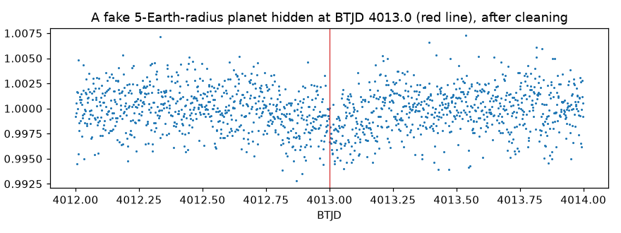

# Lab 6: hide your own fake planets

<p class="ss-meta">Lab · at your PC · about 20 min (the script runs 3 to 5 minutes) · Level L5 · after Chapter 9</p>

!!! plain "In plain words"
    You hide 20 fake planets (5 sizes, 4 places each) in real TOI-1338 data and run our search on every one. The table shows which were found, and how much of each dip survived our cleaning. You've just measured what our search can see.

**Goal:** run an injection and recovery test yourself, and read its result.

## Do it

```powershell
cd D:\second-sun
.\.venv\Scripts\python.exe labs\lab6_fake_planets.py
```

It runs the full search 20 times, so give it a few minutes.

## What you should see

```text
  size   depth   found at 3998.0  4013.0  4028.5  4042.0   depth kept
   3 R+   484ppm    no     no     no     no       129%
   4 R+   861ppm    no     no     no     no       109%
   5 R+  1345ppm    no    yes     no     no       100%
   6 R+  1937ppm   yes    yes    yes    yes        96%
   8 R+  3443ppm   yes    yes    yes    yes        92%
Picture saved: D:\second-sun\labs\out\lab6_fake_5re.png
```

<figure markdown>
{ width="100%" loading="lazy" }
<figcaption>The one 5-Earth-radius fake that was found (BTJD 4013.0), after cleaning. From your PC {{claim:F-048}}.</figcaption>
</figure>

## Reading it

- **R+** means Earth radii. **depth** is the textbook depth, (planet size ÷ star size)².
- **6 and 8 Earth radii: found every time.** 5: once in 4. 3 and 4: never. Same floor as the bigger tests in Chapter 9.
- **Depth kept** compares the dip's centre after cleaning with the fake's real centre depth. 92 to 96% for the big ones: cleaning barely touches them.
- **Why 129% and 109% for the small ones?** Their dips are smaller than the noise, so "depth kept" is mostly noise. A number can be computed and still mean nothing: check the size of the signal against the noise before reading a ratio.
- **The picture:** the 5-Earth-radius dip at 4013.0 is real, but you'd hardly pick it out by eye. The search found it there and not at the other three times: at the edge of the floor, luck (where the noise happens to wobble) decides.

## How the script works

1. Loads sector 98 and masks the stars' eclipses (as in Lab 4).
2. For each size and time, `transit()` uses `batman` to draw a realistic transit (a 95.2-day orbit, a star 1.25 times the Sun, limb darkening), and **multiplies** the real light curve by it, because a planet blocks a fraction of the light.
3. Runs `find_events()` and counts the fake as found if an event sits within 6 hours of where it was hidden.
4. Cleans the data and compares the dip's centre with the fake's true centre depth.

## What can go wrong

| You see | Why | Fix |
|---|---|---|
| It runs for a long time | 20 full searches | normal; 3 to 5 minutes |
| `ModuleNotFoundError: batman` | wrong Python | use `.\.venv\Scripts\python.exe` exactly |

## Your turn

1. In a copy (`lab6_mine.py`), change `SIZES = (3, 4, 5, 6, 8)` to `SIZES = (5, 5.5, 6)`. Run it. Where exactly does "usually found" begin?
2. Change `TIMES` to put one fake **inside** an eclipse: try `4010.18`, the middle of one of the stars' own eclipses (measured from the data). What happens, and why?
3. Use Chapter 9's Eq. 9.1: with 4 trials per size, how sure are you of the recovery fraction at 5.5?

**Tell me:** "Lab 6 done", the size where "usually found" begins, and what happened at 4010.18.

**Next:** [Part 4, Chapter 10: vetting](../book/10-vetting.md).
