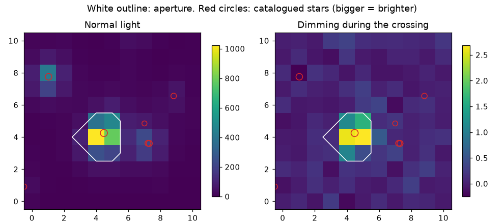

# Lab 7: is the dip on that star?

<p class="ss-meta">Lab · at your PC · about 20 min · Level L6 · after Chapter 11</p>

!!! plain "In plain words"
    You open TOI-1338's pixel file (a small movie: 11 × 11 pixels, one frame every 2 minutes) and compare the frames during the planet's crossing with the frames around it. Which pixels got dimmer? Did the centre of the light move? Which catalogued stars sit on these pixels? This is the check that catches a neighbour pretending to be a planet.

**Goal:** check for yourself that a dip is on the right star.

## What you should see

```text
Pixel file: 11 x 11 pixels, 25321 pictures, aperture of 7 pixels
Dimming summed over the aperture: 3029 ppm
Brightest pixel (the star): row 4, col 4. Most-dimmed pixel: row 4, col 5
Centroid shift during the crossing: +0.001" in row (+0.1 x the chance spread), -0.000" in column (-0.0 x)
Chance spread measured from 128 fake windows: 0.006" (row), 0.012" (column)
Catalogued stars brighter than Tmag 16 on these pixels: 8
  TIC 260128333: Tmag 11.5, 0" from our star
  TIC 260128339: Tmag 12.8, 103" from our star
  TIC 260128334: Tmag 14.0, 60" from our star
  TIC 737409351: Tmag 14.0, 61" from our star
  TIC 737409352: Tmag 14.2, 59" from our star
  TIC 260128346: Tmag 14.9, 102" from our star
Picture saved: D:\second-sun\labs\out\lab7_toi1338_pixels.png
```

<figure markdown>
{ width="100%" loading="lazy" }
<figcaption>From your PC {{claim:F-049}}.</figcaption>
</figure>

## Do it yourself

??? note "The commands, when you are at your PC"

    ```powershell
    cd D:\second-sun
    .\.venv\Scripts\python.exe labs\lab7_pixels.py
    ```

    It reads a 50 MB file already on D: and asks MAST for the neighbours, so give it a minute.

## Reading it

- **Aperture of 7 pixels:** SPOC adds up these 7 pixels (white outline) to make the light curve.
- **Dimming 3,029 ppm** summed over the aperture: more than the cleaned light curve's 1,989 ppm (Lab 4). These are **raw** pixels with no cleaning, and this crossing comes just after a data gap, where the light is probably still settling (scattered light). Raw numbers need care.
- **Brightest pixel and most-dimmed pixel are neighbours** (columns 4 and 5): the dimming is on our star.
- **Centroid shift: about zero**, compared with a chance spread measured from 128 quiet windows. Chapter 11 works out that a neighbour 60″ away would have moved it about 0.12″: 10 to 20 times the chance spread.
- **The neighbours:** the 12.8-magnitude star 103″ away is the bright patch at upper left in the picture, and it doesn't dim. The three 14th-magnitude stars about 60″ away sit right of the aperture.
- **Your own star is listed first, at 0″,** with Tmag 11.5.

## How the script works

1. `lk.read()` opens the pixel file, dropping flagged frames.
2. Frames within 0.12 days of the crossing are "in"; frames 0.22 to 0.72 days away are "out". `out − in` per pixel is the **difference image**.
3. `estimate_centroids()` gives the light's centre in every frame. The shift is the median in minus the median out, times 21″ per pixel.
4. The **chance spread**: the same measurement repeated every quarter day across the sector (away from the crossing), and the robust spread of all those fake shifts.
5. Neighbours come from the TIC; `tpf.wcs` (the file's map from sky to pixels) places them on the picture.

## What can go wrong

| You see | Why | Fix |
|---|---|---|
| `IndexError` | the pixel file isn't on D: | tell me; it's in `data\wave-2` |
| The MAST step fails | no internet | the first part still works; run again later |

## Your turn

1. Change `EV, W = 4025.64, 0.12` in a copy (`lab7_mine.py`) to `EV, W = 4010.18, 0.12`: the middle of one of the **stars' own eclipses** (measured from the data). Run it.
2. Compare: where is the dimming now, how deep, and does the centre move? Why does an eclipse of our own binary still look "on target"?
3. **Think:** what would the dimming image look like if the 12.8-magnitude neighbour were the one eclipsing?

**Tell me:** "Lab 7 done" and your three answers.

**Back to:** [Try it yourself, Part 4](../parts/part4/labs.md)
