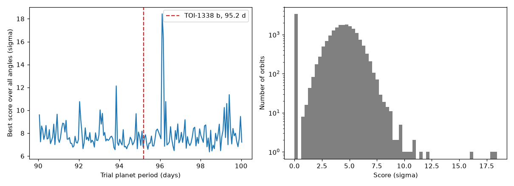

# Lab 8: read STANLEY's output

<p class="ss-meta">Lab · at your PC · about 15 min · Level L5 · after Chapter 12</p>

!!! plain "In plain words"
    STANLEY already searched TOI-1338 on your PC (33 minutes, on 20 October). Its result is a big table: one score for each of 20,482 guessed planet orbits. This lab reads that table, prints the best orbits, and draws a picture, so you can judge the result yourself.

**Goal:** read a professional search result and decide how much to trust it.

## Do it

```powershell
cd D:\second-sun
.\.venv\Scripts\python.exe labs\lab8_read_stanley.py
```

It only reads files, so it takes a few seconds. (Re-running the search itself takes about 33 minutes; that's optional, later.)

## What you should see

```text
Grid: 173 trial periods from 90.05 to 100.03 days x up to 123 starting angles = 20482 orbits tried
  period  96.11 d: best score  18.4 sigma
  period  96.16 d: best score  16.3 sigma
  period  93.84 d: best score  12.1 sigma
  period  99.41 d: best score  11.4 sigma
  period  96.28 d: best score  10.8 sigma
Typical score (median): 4.2 sigma; scores above 5 sigma: 28% of all orbits
TOI-1338 b's published period: 95.2 days (Kostov et al. 2020)
Picture saved: D:\second-sun\labs\out\lab8_stanley_toi1338.png
```

<figure markdown>
{ width="100%" loading="lazy" }
<figcaption>STANLEY on TOI-1338, from your PC {{claim:F-045}}.</figcaption>
</figure>

## Reading it

- **Three of the top five sit within about 1 day of the real planet** (96.11, 96.16, 96.28). That clustering is a good sign: a real signal is strong over a small patch of guesses, not at one lucky point.
- **93.84 and 99.41 days** score 11 to 12σ. Are those planets? Almost certainly not: they're how high noise and leftover wiggles can reach in 20,482 tries.
- **The histogram's tall bar at 0:** about 3,400 orbits have a score of exactly 0. STANLEY's output doesn't say why (an orbit it skipped, or one with no crossings during the data are the likely reasons, **UNCERTAIN**). They're counted in the 28%, so the true share of noise orbits above 5σ is a little higher.
- **The hump at 4 to 5σ:** that's what "nothing" looks like in this search. A score has to stand well clear of it.

## How the script works

1. **The trial periods.** STANLEY saves its grid as a text file. The script pulls out every number and keeps those between 85 and 105 days (stored in seconds).
2. **The scores.** A numpy file with one row per period and one column per starting angle. `-29` marks unused cells (some periods have fewer angles), which become "missing".
3. It reports each period's best score, the typical score, and draws both panels.

!!! note "Why step 1 matters"
    STANLEY's log prints the period range from high to low, and our first reading assumed the table ran that way: wrong, giving 93.8 days. The saved grid runs low to high, and the number of angles per period (114 rising to 123) matches the table row by row. That's how we know the order. Lesson: read the axis from the data file, not from a log message.

## What can go wrong

| You see | Why | Fix |
|---|---|---|
| `FileNotFoundError` | the STANLEY output folder moved | it lives in `D:\second-sun\data\stanley\PlanetSearchOutput\ss_toi1338_rec` |
| `cannot reshape array` | the grid file and the results don't match | tell me: the run may have been redone |

## Your turn

1. Look at the left panel. Besides 96.1 days, which period has the next-highest isolated spike?
2. **Decide like a scientist:** if this were an unknown star, would you report "a planet at 96.1 days"? Write two sentences: what you'd claim, and what test you'd want first.

**Tell me:** "Lab 8 done" and your two sentences. (There's no single right answer; Chapter 12's section 12.6 has mine.)

**Next:** Part 6, [Chapter 13: your workshop](../book/13-your-workshop.md).
